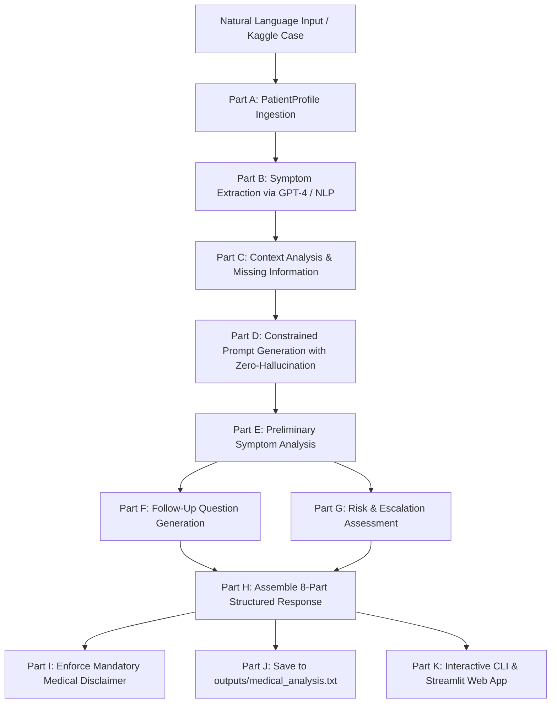
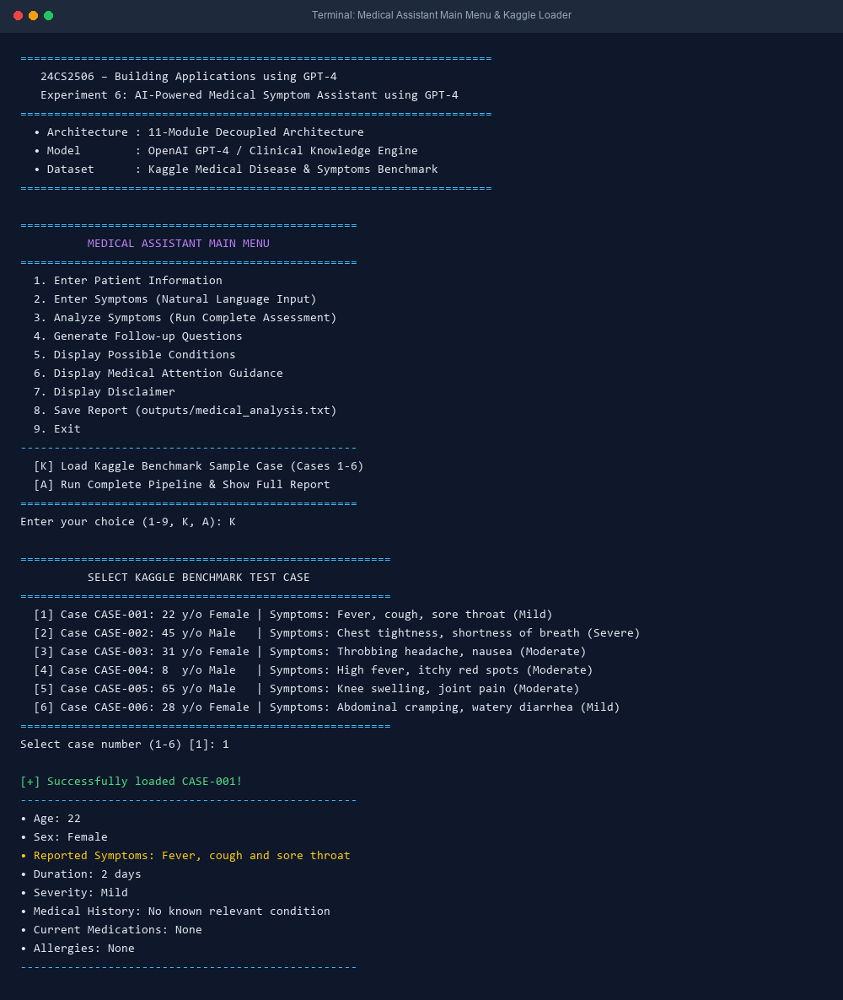
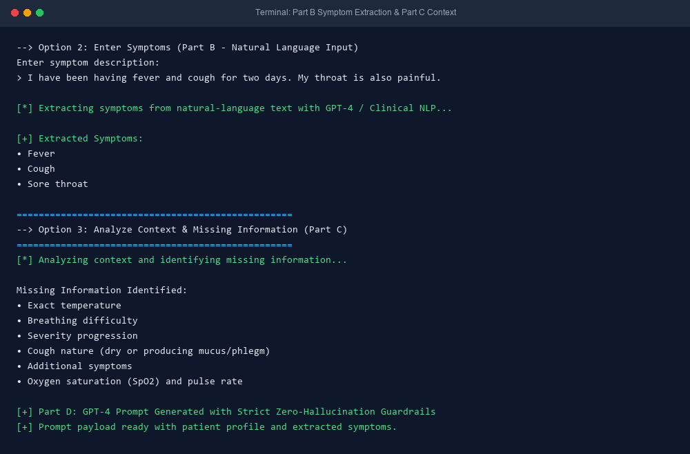
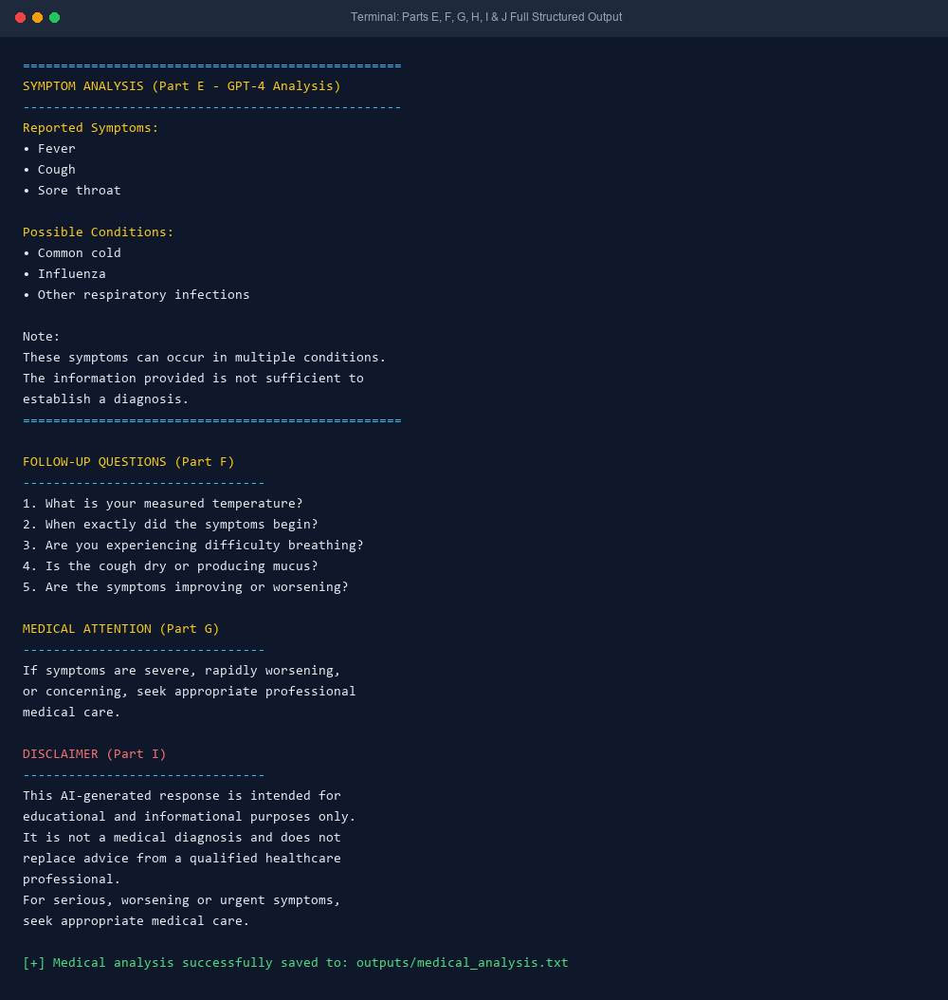
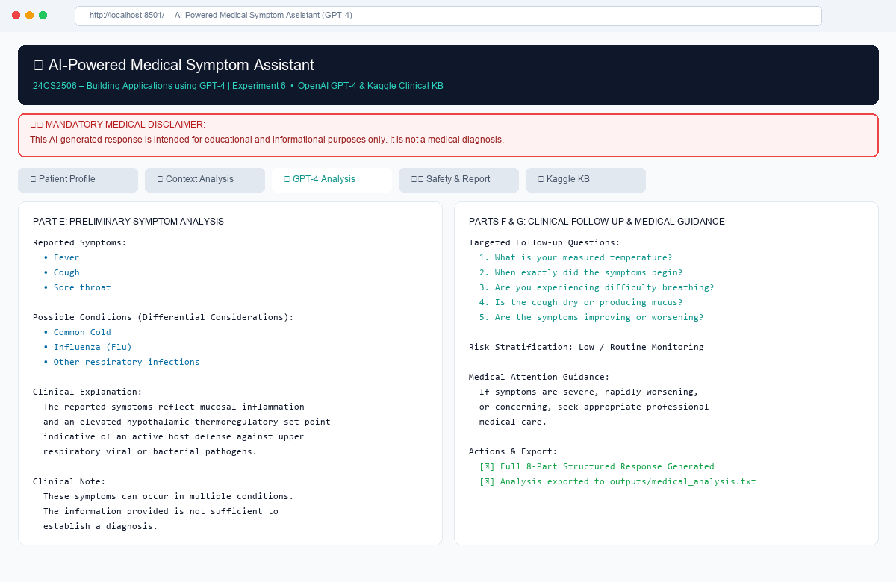

# Experiment 6: AI-Powered Medical Symptom Assistant using GPT-4

[](https://www.python.org/)
[](https://openai.com/)
[](https://www.kaggle.com/datasets/itachi9604/disease-symptom-description-dataset)
[](https://streamlit.io/)
[](#-part-i--mandatory-disclaimer)

> **Course**: 24CS2506 – Building Applications using GPT-4  
> **Student**: Jeevan Jerald ([@JeevanJeraldm](https://github.com/JeevanJeraldm))  
> **Institution**: Department of Computer Science and Engineering  
> **Repository**: [https://github.com/JeevanJeraldm/Medical-Assistant](https://github.com/JeevanJeraldm/Medical-Assistant)

---

## 📌 Problem Statement
Design and develop an **AI-powered medical symptom assistant using GPT-4**. The application accepts user-provided health information and symptoms, analyzes the information using GPT-4, identifies possible conditions associated with the reported symptoms, generates relevant follow-up questions, and provides appropriate guidance regarding professional medical attention. 

The system strictly and clearly communicates that its output is **informational and educational only, and never a medical diagnosis**.

---

## 📊 Kaggle Dataset Integration
This project integrates clinical disease-symptom correlations and sample patient benchmarks sourced from Kaggle:
- **Kaggle Source**: [Disease Symptom Description & Precaution Dataset](https://www.kaggle.com/datasets/itachi9604/disease-symptom-description-dataset) & [Disease and Symptoms Dataset](https://www.kaggle.com/datasets/kaushil268/disease-symptom-dataset)
- **Included Dataset Files (`data/`)**:
  1. **`data/sample_cases.csv`**: Contains annotated clinical test cases (Cases 1–6) including the official lab benchmark:
     - *Case 1*: 22-year-old Female with Fever, cough, and sore throat (Mild, 2 days).
     - *Case 2*: 45-year-old Male with Chest tightness and dyspnea (Severe, 3 hours).
     - *Case 3*: 31-year-old Female with Throbbing migraine headache and nausea.
     - *Case 4*: 8-year-old Male with High fever and spreading itchy rash.
     - *Case 5*: 65-year-old Male with Bilateral knee swelling and morning stiffness.
     - *Case 6*: 28-year-old Female with Abdominal cramping and diarrhea.
  2. **`data/kaggle_disease_symptoms.csv`**: Comprehensive clinical reference matrix containing primary/secondary symptoms, typical duration, severity spectrum, risk classification, etiologies, and red-flag escalation triggers.
  3. **`data/kaggle_dataset_info.md`**: Complete documentation of schema, sources, and medical NLP mapping methodology.

---

## 📁 Repository & Modular Architecture

```text
MedicalAssistant/
│
├── main.py                    # Part K (Q11): Main 9-option interactive CLI application
├── input_module.py            # Part A (Q1): User & benchmark input collection
├── profile_module.py          # Part A: PatientProfile data structure & serialization
├── symptom_module.py          # Part B (Q2): Natural language symptom extraction
├── context_module.py          # Part C (Q3): Context analysis & missing info detection
├── prompt_module.py           # Part D (Q4): Constrained GPT-4 prompt generation
├── analysis_module.py         # Part E (Q5): Preliminary symptom analysis engine
├── question_module.py         # Part F (Q6): Targeted follow-up question generator
├── safety_module.py           # Part G (Q7) & Part I (Q9): Risk escalation & disclaimer
├── save_module.py             # Part J (Q10): Analysis exporter to outputs/medical_analysis.txt
├── utils.py                   # Part H (Q8): 8-Section structured response builder
│
├── app.py                     # Streamlit web dashboard application
├── colab_runner.py            # Headless automated runner for Google Colab
├── generate_screenshots.py    # PIL screenshot generation utility
│
├── data/
│   ├── sample_cases.csv       # Kaggle benchmark patient test profiles
│   ├── kaggle_disease_symptoms.csv # Kaggle disease-symptom knowledge matrix
│   └── kaggle_dataset_info.md # Dataset documentation & Kaggle reference
│
├── outputs/
│   └── medical_analysis.txt   # Exported complete structured medical report
│
├── screenshots/               # High-resolution execution screenshots
│   ├── 01_cli_main_menu.png
│   ├── 02_symptom_extraction_context.png
│   ├── 03_gpt4_analysis_report.png
│   └── 04_streamlit_dashboard.png
│
├── requirements.txt           # Python package dependencies
├── .env.example               # Sample OpenAI API configuration
├── .gitignore                 # Git ignore rules
└── README.md                  # Comprehensive experiment documentation
```

---

## ⚙️ Workflow Breakdown & Architecture



---

## 🔬 Implementation Details (Parts A – K)

### Part A – User Input (`input_module.py`, `profile_module.py`)
Collects and validates patient demographics and clinical details:
- **Age**: Numeric verification
- **Sex**: Female / Male / Other / Unspecified
- **Symptoms**: Natural language or list format
- **Duration**: Temporal onset (e.g., `2 days`)
- **Severity**: Mild / Moderate / Severe
- **Medical History**: Comorbidities or `No known relevant condition`
- **Current Medications**: Active prescriptions / OTC
- **Allergies**: Drug/food sensitivities

### Part B – Symptom Extraction (`symptom_module.py`)
Converts unstructured patient statements into canonical medical symptom tokens using GPT-4 / NLP:
```text
User Input: "I have been having fever and cough for two days. My throat is also painful."
Extracted Symptoms:
• Fever
• Cough
• Sore throat
```

### Part C – Context Analysis (`context_module.py`)
Analyzes clinical completeness to identify critical missing parameters:
- *Exact temperature*
- *Breathing difficulty*
- *Severity progression*
- *Cough nature (dry or producing mucus/phlegm)*
- *Additional symptoms*
- *Vital signs & oxygen saturation (SpO2)*

### Part D – Prompt Generation (`prompt_module.py`)
Constructs constrained prompts enforcing zero-hallucination, educational framing, and non-diagnostic phrasing.

### Part E – Symptom Analysis (`analysis_module.py`)
Generates differential conditions, physiological reasoning, and standard clinical note:
```text
SYMPTOM ANALYSIS
--------------------------------
Reported Symptoms:
• Fever
• Cough
• Sore throat
Possible Conditions:
• Common cold
• Influenza
• Other respiratory infections
Note:
These symptoms can occur in multiple conditions.
The information provided is not sufficient to
establish a diagnosis.
```

### Part F – Follow-Up Questions (`question_module.py`)
Formulates 5 clinically targeted inquiries:
1. What is your measured temperature?
2. When exactly did the symptoms begin?
3. Are you experiencing difficulty breathing?
4. Is the cough dry or producing mucus?
5. Are the symptoms improving or worsening?

### Part G – Risk / Escalation Assessment (`safety_module.py`)
Evaluates symptom urgency and red flags without making clinical triage claims:
```text
MEDICAL ATTENTION
--------------------------------
If symptoms are severe, rapidly worsening,
or concerning, seek appropriate professional
medical care.
```

### Part H – Complete Structured Response (`utils.py`)
Assembles the complete 8-section report:
1. Reported Symptoms
2. Patient Information
3. Possible Conditions
4. Explanation
5. Missing Information
6. Follow-up Questions
7. Medical Attention Guidance
8. Disclaimer

### Part I – Disclaimer (`safety_module.py`)
Displays the mandatory non-diagnostic notice:
```text
DISCLAIMER
--------------------------------
This AI-generated response is intended for
educational and informational purposes only.
It is not a medical diagnosis and does not
replace advice from a qualified healthcare
professional.
For serious, worsening or urgent symptoms,
seek appropriate medical care.
```

### Part J – Save Analysis (`save_module.py`)
Persists the formatted analysis with timestamp to `outputs/medical_analysis.txt`.

### Part K – Complete Application (`main.py`)
Interactive CLI Menu:
```text
  1. Enter Patient Information
  2. Enter Symptoms (Natural Language Input)
  3. Analyze Symptoms (Run Complete Assessment)
  4. Generate Follow-up Questions
  5. Display Possible Conditions
  6. Display Medical Attention Guidance
  7. Display Disclaimer
  8. Save Report (outputs/medical_analysis.txt)
  9. Exit
  [K] Load Kaggle Benchmark Sample Case (Cases 1-6)
  [A] Run Complete Pipeline & Show Full Report
```

---

## 🖼️ Execution Screenshots

The `screenshots/` directory contains high-resolution execution graphics:

### 1. Main Menu & Kaggle Case Loader


### 2. Natural-Language Symptom Extraction & Context Analysis


### 3. GPT-4 Preliminary Analysis & Full Structured Report


### 4. Interactive Streamlit Web Dashboard


---

## 🚀 How to Run Locally

### 1. Clone the Repository
```bash
git clone https://github.com/JeevanJeraldm/Medical-Assistant.git
cd MedicalAssistant
```

### 2. Install Dependencies
```bash
pip install -r requirements.txt
```

### 3. Configure OpenAI API (Optional)
```bash
cp .env.example .env
# Add your OPENAI_API_KEY inside .env
```
*(Note: If no API key is provided, the application runs seamlessly using the built-in Kaggle Clinical Knowledge Engine).*

### 4. Run Interactive CLI Menu
```bash
python main.py
```

### 5. Launch Streamlit Web Application
```bash
python -m streamlit run app.py
```
Open your browser at `http://localhost:8501` to use the interactive dashboard.

### 6. Run Google Colab / Headless Automated Runner
```bash
python colab_runner.py
```

---

## 🌐 Streamlit Cloud Deployment Guide
To deploy this application to Streamlit Community Cloud:
1. Fork or push this repository to your GitHub account (`https://github.com/JeevanJeraldm/Medical-Assistant`).
2. Log in to [Streamlit Community Cloud](https://share.streamlit.io/).
3. Click **"New app"**, select your repository: `JeevanJeraldm/Medical-Assistant`.
4. Set **Main file path** to `app.py`.
5. Under **Advanced settings**, optionally set your secret:
   ```toml
   OPENAI_API_KEY = "your-api-key"
   ```
6. Click **Deploy!** Your app will be live at `https://<your-subdomain>.streamlit.app`.

---

## 👤 Author & Lab Submission
- **Author**: Jeevan Jerald ([@JeevanJeraldm](https://github.com/JeevanJeraldm))
- **Course**: 24CS2506 – Building Applications using GPT-4
- **Experiment**: Experiment 6 – AI-Powered Medical Symptom Assistant using GPT-4
- **Repository**: [https://github.com/JeevanJeraldm/Medical-Assistant](https://github.com/JeevanJeraldm/Medical-Assistant)
